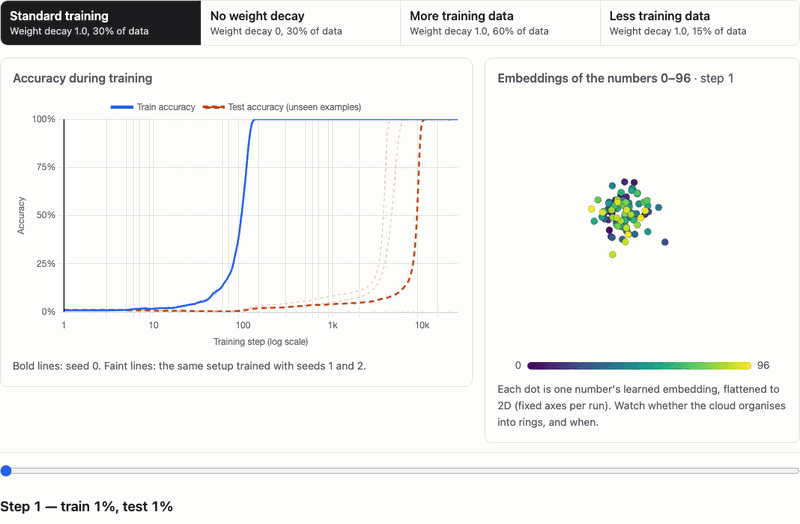
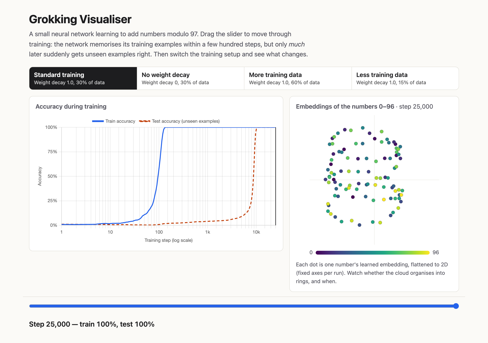
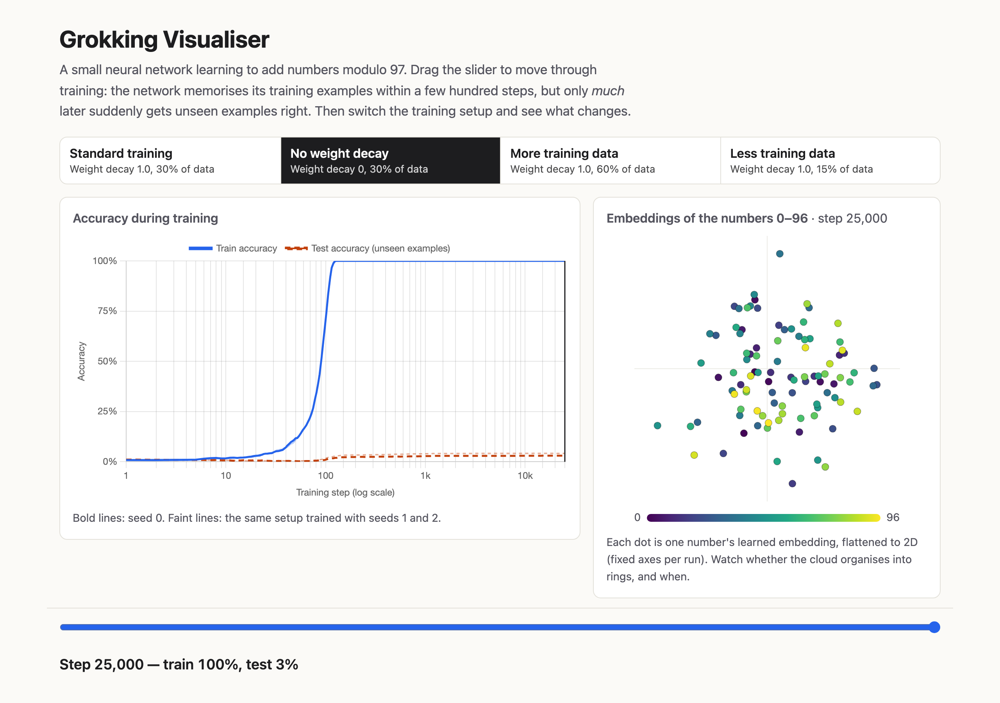

# Grokking Visualiser

Watch a tiny neural network memorise modular arithmetic in 130 steps, then
suddenly *generalise* thousands of steps later, and see that without weight
decay it never does.

**Live:** [skape007-ult.github.io/grokking-visualiser/](https://skape007-ult.github.io/grokking-visualiser/)



## The finding

A 1-layer transformer trained on 30% of all `(a + b) mod 97` sums hits 99%
training accuracy by step ~130, but only crosses 95% on unseen sums thousands
of steps later: at step 4,216, 5,785 and 9,868 in three seeds. With weight
decay switched off and everything else identical, none of the three seeds
generalises. They memorise just as fast and are still at 3–4% on unseen sums
after 25,000 steps.

| setting (3 seeds each) | test acc ≥ 95% at step | final test acc |
|---|---|---|
| Standard (weight decay 1.0, 30% of data) | 4,216 / 5,785 / 9,868 | 100% / 100% / 100% |
| No weight decay | never | 3.0% / 4.1% / 4.3% |
| More data (60%) | 269 / 370 / 489 | 100% in all three |
| Less data (15%) | never | 0.4–1.1% (chance ≈ 1%) |

## Limitations

- **One task, one prime, one architecture:** addition mod 97 with a 1-layer
  transformer. Other operations, primes and model sizes are untested here.
- **Three seeds per setting.** Enough to show none of the results is a
  one-run fluke, but too few to characterise the timing distribution. The
  grokking step already varies 2.3× across them.
- **"Never" means "not within 25,000 steps".** The no-decay and less-data runs
  might generalise much later.
- **The 2-D embedding view is lossy:** the top two PCA directions capture only
  8–27% of the embedding variance. It shows dominant structure, not
  everything the network learned.
- **Timing is sensitive to tiny numerical differences:** a ~1e-8 change once
  shifted the grokking step by 5%. Treat single step numbers as approximate.

## How to reproduce

Tested on an Apple M3 MacBook (CPU), Python 3.14. Each of the 4 settings is
trained with 3 seeds (12 runs). Run time scales with the training-set size
(full-batch): on its own a run takes ~2 min (`less_data`), ~4.5 min
(`baseline`, `no_decay`) or ~9 min (`more_data`), so `./run_all.sh` takes about
an hour. `JOBS=4 ./run_all.sh` trains in parallel with identical results (54 min
measured; the M3 has 4 performance cores, so the gain is small). Runs are
deterministic, and a from-scratch rerun reproduced `site/data/` and the plots
byte-for-byte.

```bash
python3 -m venv .venv
.venv/bin/pip install -r requirements.txt
./run_all.sh                     # train all 4 runs, project, export, validate, plot
```

or step by step:

```bash
.venv/bin/python train/train.py --run baseline             # ~4.5 min (seed 0)
.venv/bin/python train/train.py --run baseline --seed 1    # likewise seeds 1, 2 and the
                                                           # other runs: no_decay, more_data, less_data
.venv/bin/python train/project.py baseline no_decay more_data less_data
.venv/bin/python train/export.py
.venv/bin/python train/validate.py
cd site && python3 -m http.server 8000             # open http://localhost:8000
```

Runs are deterministic (seeded, `torch.use_deterministic_algorithms`, CPU),
so this regenerates `site/data/` byte-for-byte on the same software stack.
Opening `site/index.html` straight from disk won't work (browsers block `fetch`
on `file://`), so serve it over HTTP as above.

Optional browser checks (Chromium, WebKit/Safari, Firefox):

```bash
.venv/bin/pip install -r requirements-dev.txt
.venv/bin/python -m playwright install chromium webkit firefox
.venv/bin/python check_site.py --browsers all     # add --screenshots to refresh images/GIF
```

### Publish to GitHub Pages

1. Create an empty GitHub repo (e.g. `grokking-visualiser`), with no README.
2. `git remote add origin git@github.com:<you>/grokking-visualiser.git && git push -u origin main`
3. On GitHub: **Settings → Pages → Build and deployment → Source: "GitHub Actions"**.
4. If the first push ran before Pages was enabled, re-run "Deploy site to GitHub
   Pages" from the **Actions** tab. The site goes live at
   `https://<you>.github.io/grokking-visualiser/`.

## Project structure

How each piece works, function by function, and the JSON contract between
`train/` and `site/`: [ARCHITECTURE.md](ARCHITECTURE.md).

```
grokking-visualiser/
├── README.md
├── ARCHITECTURE.md               how every stage and file works
├── LICENSE                       MIT
├── requirements.txt              pinned: torch, numpy, matplotlib
├── requirements-dev.txt          pinned: playwright, pillow (site checks only)
├── run_all.sh                    end-to-end reproduction
├── check_site.py                 browser checks (Chromium/WebKit/Firefox) + screenshots/GIF
├── .github/workflows/pages.yml   deploys site/ to GitHub Pages on push to main
├── train/
│   ├── config.py                 RunConfig dataclass, the 4-run sweep, the seeds
│   ├── data.py                   (a + b) mod p dataset, seeded train/test split
│   ├── model.py                  1-layer transformer (Nanda et al. style, no LayerNorm)
│   ├── train.py                  one run: train, log-spaced metrics, embedding snapshots
│   ├── project.py                fixed-basis PCA (fit on final snapshot, project all frames)
│   ├── export.py                 the only writer of site/data/ (rounded, contract-shaped JSON)
│   ├── validate.py               asserts site/data/ matches the data contract
│   └── plot.py                   diagnostic plots + milestone summaries
├── site/
│   ├── index.html                page + explanation text
│   ├── app.js                    chart, embedding canvas, slider, run toggle
│   ├── style.css                 layout (responsive, single column < 720px)
│   ├── og-image.png              social preview image
│   └── data/                     manifest.json + runs/*.json (generated, committed)
├── notes/
│   ├── log.md                    dated work log of every attempt + summary
│   ├── plots/                    phase0_baseline.png, phase1_sweep.png
│   └── screenshots/              desktop, mobile, scrub.gif
└── outputs/                      (gitignored) raw metrics + embedding snapshots
```

## What I'd do next

- Measure the timing distribution properly: 10–20 seeds per setting (three
  seeds already span 4,216–9,868 steps).
- Find out whether `less_data` groks with a longer budget (100k+ steps), or
  never does.
- Sweep weight decay between 0 and 1 to find where grokking turns on, and
  how the delay scales.
- Explain the rings: they are not ordered by number value, which is
  consistent with Nanda et al.'s Fourier-feature account but not verified here.

## References

- Power, Burda, Edwards, Babuschkin & Misra (2022). *Grokking: Generalization
  Beyond Overfitting on Small Algorithmic Datasets.* [arXiv:2201.02177](https://arxiv.org/abs/2201.02177)
- Nanda, Chan, Lieberum, Smith & Steinhardt (2023). *Progress measures for
  grokking via mechanistic interpretability.* [arXiv:2301.05217](https://arxiv.org/abs/2301.05217)

Demo video: https://youtu.be/46L25QsymwI

---

## Appendix: build notes by phase

What was built in each phase and why the key decisions were made. Numbers
here are as of each phase (seed 0 only until the review passes); the current
results are in [The finding](#the-finding). The full dated log, including
failures, is in [`notes/log.md`](notes/log.md).

### Phase 0 — Make it grok

**What was built.** A config-driven training pipeline (`train/`) for a
1-layer transformer on `(a + b) mod 97`, and a baseline run that reproduces
grokking: train accuracy hits 99% by step 130, test accuracy stays near chance
for thousands of steps, then jumps to 95% at step ~10 000
(`notes/plots/phase0_baseline.png`). It worked on the first attempt — see
`notes/log.md`.

**Key decisions and why.**
- *No LayerNorm, deliberately.* Nanda et al. removed it to make the trained
  network easier to interpret (no per-token normalisation mixing directions),
  and it still groks reliably at this size.
- *Follow Nanda et al. 2023 closely* (no LayerNorm, learned positional
  embeddings, untied embed/unembed, AdamW lr 1e-3, wd 1.0, betas (0.9, 0.98),
  10-step warmup, full batch, 30% data) because it is the most reliable known
  recipe. Deviations: p = 97 instead of 113, and inputs are 4 tokens
  `[a, op, b, =]` instead of 3.
- *Logits over the 97 answers only*, not the full 99-token vocabulary: `op` and
  `=` can never be answers, so there is nothing to learn there.
- *Only the `=` position is computed in the last block.* Only that position's
  output feeds the logits, so this is exact (verified: max diff 0.0) and makes a
  step ~2.6× cheaper (~13 ms on an Apple M3).
- *CPU by default, deterministic algorithms on.* On the M3 CPU and MPS are the
  same speed here; CPU supports the float64 loss, and with
  `torch.use_deterministic_algorithms(True)` a run is bit-for-bit regenerable
  from its config (the embedding backward pass is otherwise nondeterministic).
  `device=auto` selects CUDA → MPS → CPU if you prefer.
- *Every run is a `RunConfig`* (`train/config.py`); exploratory variants use
  `--set key=value` rather than edited constants, and the full config is saved
  next to every result.

### Phase 1 — Sweep and export

**What was built.** Four runs that differ from `baseline` in exactly one
variable, a fixed-basis PCA projection of the embeddings, and an exporter +
validator for the data the site consumes (`site/data/`).

| run (UI label) | change | outcome (25 000 steps) |
|---|---|---|
| `baseline` ("Standard training") | — | groks: test acc 95% at step ~10 000 |
| `no_decay` ("No weight decay") | weight decay 0 | memorises, test acc stuck at 3% |
| `more_data` ("More training data") | 60% of pairs | generalises almost immediately (95% at step 378) |
| `less_data` ("Less training data") | 15% of pairs | memorises, test acc at chance (~1%) |

Diagnostic plot: `notes/plots/phase1_sweep.png`.

**Key decisions and why.**
- *200 log-spaced recorded steps, 40 embedding snapshots.* Grokking spans
  four orders of magnitude of steps, so linear spacing would waste almost every
  point on the flat tail.
- *PCA basis fitted once per run, on the final snapshot,* and every frame is
  projected onto it. Fitting per frame would let the axes rotate between frames,
  making the animation meaningless. Component signs are fixed deterministically.
- *Raw outputs live in gitignored `outputs/`; only `site/data/` is committed,*
  and only `train/export.py` writes it. `train/validate.py` enforces the data
  contract (lengths, ranges, rounding, frame steps ⊂ steps, file sizes,
  manifest ↔ files) and that first and final frames differ, which catches the
  snapshot-aliasing bug described in `notes/log.md`.

### Phase 2 — The curves, online

**What was built.** `site/`: a static page (plain HTML + vanilla JS +
Chart.js 4.4.1 from jsDelivr, no build step) showing train and test
accuracy on a log-step axis, with a slider that moves a marker along the
chart and updates a readout ("Step 9,675 — train 100%, test 94%"). A
GitHub Actions workflow publishes `site/` to GitHub Pages.

**Key decisions and why.**
- *The slider indexes recorded steps, not raw step numbers,* so it moves
  evenly along the log axis (otherwise the first 1 000 steps, where
  memorisation happens, would be squeezed into 4% of the track).
- *Relative fetch paths* (`data/manifest.json`), so the same files work from
  `python -m http.server` and under the Pages subpath `/<repo>/`.
- *Chart animations off;* moving the slider only redraws the marker
  (`chart.draw()`), with no data update, so scrubbing feels instant.
- *Headless check* (`check_site.py`, Playwright) serves `site/`, then at
  desktop and phone sizes asserts no console errors or failed requests, that
  the chart renders, that keyboard, mouse-drag and touch move the readout, and
  that there's no horizontal scroll on mobile. Playwright is a dev-only
  dependency (`requirements-dev.txt`). Commands for previewing, checking and
  deploying are under [How to reproduce](#how-to-reproduce).

### Phase 3 — Embeddings and the run toggle

**What was built.**
- *Embedding panel:* the 97 number embeddings in each run's fixed 2-D PCA
  basis, driven by the same slider (it shows the latest snapshot at or
  before the slider's step). Fixed, equal-aspect axis limits per run; viridis
  colouring by value with a legend; hover (or tap) shows the number, and a
  click/tap pins it so you can follow one number through training.
  Hand-drawn `<canvas>`, sized to the device pixel ratio so it stays crisp.
- *Run toggle:* four real `<button>`s with `aria-pressed`, built from the
  manifest. Switching keeps the slider at the same step, refits the embedding
  axes, lazy-loads and caches the run, and writes `#run=<id>` to the URL.
  Deep links like `#run=no_decay` work.
- *Explanation:* three paragraphs plus references, with every number taken
  from the exported data (and checked by `check_site.py`).
- *Mobile:* single column under 720px; the slider + readout bar is sticky at
  the bottom of the screen while the visualisation is in view, so you can
  scrub while looking at either panel. Touch targets ≥ 44px.

**Key decisions and why.**
- *Show the latest embedding snapshot at or before the slider's step,* never
  a later one: the panel should never show the future.
- *Equal x/y scale,* because distances in PCA space are meaningful; stretching
  one axis would distort the rings.
- *Static explanation text, checked against the data,* rather than text
  generated in JS: easy for a human to edit, still impossible to go stale
  silently.

Screenshots and the GIF (from `check_site.py --screenshots`): `notes/screenshots/`. Below: the same moment (step 25,000) with and without weight decay.

 

### Phase 4 — Polish

- `<title>`, meta description, Open Graph / Twitter card tags (preview image
  `site/og-image.png`, generated by `check_site.py`), an inline SVG favicon
  (no extra request, no 404).
- Chart.js is pinned to 4.4.1 with a Subresource Integrity hash.
- Accessibility: segmented run buttons are real `<button>`s with
  `aria-pressed`; the slider has a label and an `aria-valuetext` that mirrors
  the readout; visible focus rings; everything works from the keyboard (Tab to
  a run, Enter/Space to select, arrows/Home/End on the slider).
- Page weight: the initial view is ~103 KB gzipped (Chart.js ~70 KB, baseline
  run JSON ~24 KB, page/CSS/JS ~9 KB). The other runs (~24 KB gzipped each)
  load only when selected. `site/` contains nothing unused.

### Review pass (after Phase 4)

A full review of the code produced these fixes. All are covered by new
`check_site.py` checks, which fail on the old code and pass on the new.
- **Mobile scrolling:** the embedding canvas used `touch-action: none`, so a
  swipe starting on it (most of a phone's width) couldn't scroll the page. It
  now uses `manipulation`, and pinning uses `click`.
- **Failed run load:** this left the new button pressed over the old data, with
  no message. It now shows an error, reverts the toggle, and can be retried.
- **Screen readers:** the readout's `aria-live` duplicated the slider's
  `aria-valuetext` on every drag tick, so it was removed.
- **Efficiency:** CSS colours and the 97 point colours are computed once instead
  of on every slider move. `export.py` reads and checks every run before
  touching `site/data/`.
- **Pages workflow:** added the `actions: read` permission that
  `deploy-pages` v4+ requires, and updated to the current major versions.
- **Cross-browser:** checks now run in Chromium, WebKit (iPhone 13 profile) and
  Firefox, and all pass.

### Second review pass: seeds and robustness

- **Three seeds per setting** (`SEEDS` in `config.py`, `--seed` on
  `train.py`). Every conclusion held in all three: standard training groks
  (95% at 4,216 / 5,785 / 9,868), no weight decay never does (3–4% final),
  more data has almost no delay, and less data stays at chance. The site
  draws the other two seeds as faint lines, and the explanation text quotes
  ranges, checked against the data by `check_site.py`.
- **Denser frames around the transition.** Log spacing put only two
  embedding frames between 21% and 94% test accuracy, so the rings appeared
  to snap into place. Recording is now adaptive (extra records while test
  accuracy moves fast, plus a snapshot every 5 points of test accuracy),
  giving 10 frames across that window. The slider uses 400 log-uniform
  positions, so it still moves evenly.
- **Accessibility:** the embedding canvas's `aria-label` now describes the
  current frame (run, step, test accuracy), as its text alternative.
- **One source of truth for the run list:** `validate.py` reads it from
  `config.py`, and `check_site.py` from the manifest.
- Limitations section, the LayerNorm rationale, and an MIT `LICENSE`.

