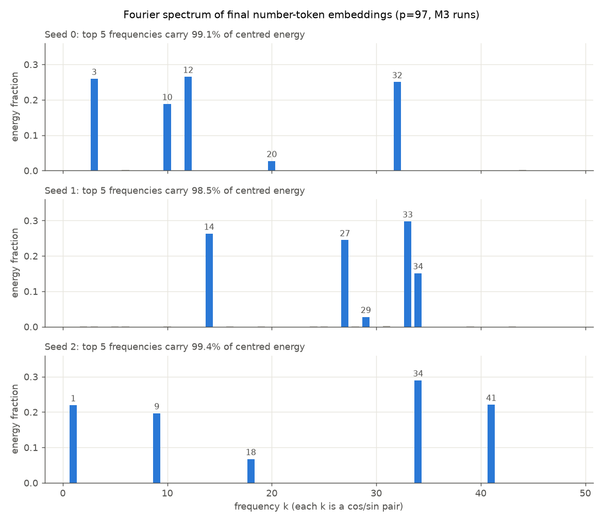
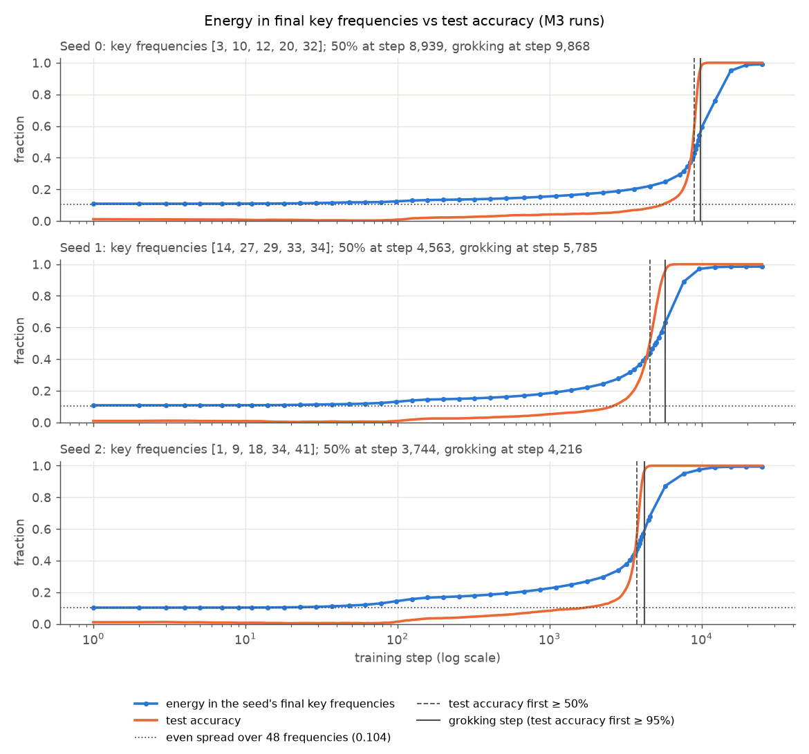

# Are the baseline embedding rings Fourier features?

Question: the site shows the number-token embeddings of the `baseline` run
organising into rings. Is that structure the sparse Fourier representation
reported by Nanda et al. 2023 ("Progress measures for grokking via mechanistic
interpretability")? This note tests that **at the embedding level only**.

Every result below, except the cloud comparison, comes from the Apple M3 runs
that match the site. Numbers come from the CSV files named in each section.

Script: `notes/fourier_analysis.py` (standalone; parameterised by output
directory). The runs are the existing weight-decay sweep outputs and were not
retrained. To reproduce from the repo root (run the training command only if
the outputs are missing):

```bash
.venv/bin/python train/train.py --run baseline --seed S --set weight_decay=1.0 --tag wd1.0__seedS  # S = 0, 1, 2
.venv/bin/python notes/fourier_analysis.py --outputs outputs
```

## Setup

- Task `(a + b) mod p`, **p = 97**, 30% train split, weight decay 1.0, 25k
  full-batch AdamW steps. Model: 1 layer, 4 heads, d_model 128, d_mlp 512, no
  LayerNorm, logits read from the last (`=`) position (`train/config.py`,
  `train/model.py`).
- Runs: `outputs/wd1.0__seed0`, `wd1.0__seed1`, `wd1.0__seed2`, trained on the
  M3 CPU by the sweep in `notes/wd_sweep.md`. They hold 50, 50 and 51 embedding
  snapshots of the 97 number-token rows of `W_E`.
- Grokking steps (first recorded step with test accuracy ≥ 95%, from each
  `run.json`) are **seed 0 = 9,868, seed 1 = 5,785, seed 2 = 4,216**. The
  README lists the same three values sorted, not by seed. All three runs end at
  100% test accuracy.

## Method

- **Basis.** Over the token axis x = 0..96, use the orthonormal real Fourier
  basis: one constant vector plus unit-norm cos(2πkx/p) and sin(2πkx/p) vectors
  for k = 1..48. The rows of `W_E` (97 × 128) are mean-centred, which removes
  the k = 0 component, and then projected onto this basis.
- **Energy of a frequency.** The energy of frequency k is |cᵀW|² + |sᵀW|². The
  basis is complete, so the per-k energies add up exactly to ‖W − mean‖²_F, and
  the script asserts this. "Fraction" below always means a share of this energy,
  which is the same quantity whose variance PCA explains.
- **Key frequencies.** The top 5 frequencies by energy in each seed's final
  snapshot.
- **Site axes.** The final frame of `site/data/runs/baseline.json` is the array
  the page renders. Its two coordinates are compared directly with cos/sin of
  every k, without using a retrained run. As a cross-check, the same analysis
  runs on coordinates recomputed from `wd1.0__seed0` with the PCA from
  `train/project.py`.
- **Timing.** "50% crossing" and "grokking step" are the first recorded step
  with test accuracy ≥ 50% and ≥ 95%. Embedding snapshots are sparser than
  accuracy records, so when one of those steps has no snapshot the energy
  fraction is linearly interpolated in step between its two neighbours.

## Results

### 1. Spectrum of final W_E

Source: `fourier_m3_summary.csv`, `fourier_m3_spectrum.csv`.



| seed | top frequencies (energy fraction) | top-4 | top-5 | freqs for 90% |
|---|---|---|---|---|
| 0 | 12 (.265), 3 (.260), 32 (.250), 10 (.188), 20 (.027) | 0.964 | 0.991 | 4 / 48 |
| 1 | 33 (.298), 14 (.263), 27 (.245), 34 (.151), 29 (.028) | 0.957 | 0.985 | 4 / 48 |
| 2 | 34 (.290), 41 (.221), 1 (.220), 9 (.197), 18 (.067) | 0.927 | 0.995 | 4 / 48 |

If energy were spread evenly, 5 of the 48 frequencies would carry 0.104. In
every seed the final number embeddings are close to fully Fourier-sparse:
**4 frequencies carry 92.7–96.4% of the centred energy**, a weaker fifth carries
2.7–6.7%, and no other frequency carries more than 0.23%.

### 2. What the site's axes are

Source: `fourier_site_axes.csv`, `fourier_m3_pcs.csv`.

The site shows seed 0's embeddings only (other seeds appear only as accuracy
curves). Reading the final frame of the site's own data at step 25,000:

| site axis | largest frequency share | next |
|---|---|---|
| x (PC1) | k = 12: 99.7% | k = 32: 0.2% |
| y (PC2) | k = 3: 78.8% | k = 12: 20.7% |

- **The ring claim stands for the plotted run.** The x-axis is almost entirely
  frequency 12, and the y-axis is mostly frequency 3 with about a fifth
  frequency 12. Across the plane, weighted by variance, frequency 12 has 60.4%
  and frequency 3 has 39.2%; no other frequency has more than 0.3%.
- The best single frequency (k = 12) matches the plane in only one direction:
  its principal-angle cosines with the plane are 0.9985 and 0.4554. The plotted
  ring is therefore not the circle of a single cos/sin pair.
- Recomputing the coordinates from `wd1.0__seed0` gives the same shares, and
  matches the site's coordinates to 5×10⁻⁵, the size of the site's 4-decimal
  rounding.
- **This is specific to what PCA picked.** PC1 and PC2 carry 13.45% and 13.30%
  of the variance, about as much as PC3 and PC4 (13.11%, 12.78%), so PCA has
  little to separate these directions. The stability of this assignment was not
  tested. In seeds 1 and 2, which the site does not plot, PC1 and PC2 are both
  dominated by one frequency (k = 33 at 95.9% and 99.3%; k = 34 at 99.9% and
  99.9%).

The top 8 PCs span essentially the same space as cos/sin of each seed's 4
largest frequencies: the smallest principal-angle cosine is 0.998, 0.984 and
0.998 for seeds 0, 1 and 2.

### 3. Over training

Source: `fourier_m3_over_training.csv`, `fourier_m3_summary.csv`.



Blue is the energy in each seed's own final key frequencies, chosen from the
last snapshot; orange is test accuracy.

| seed | key freqs | 50% crossing (test acc) | energy there | grokking step (test acc) | energy there |
|---|---|---|---|---|---|
| 0 | {3, 10, 12, 20, 32} | 8,939 (58.4%) | 0.427 | 9,868 (97.2%) | 0.567 (interpolated: 0.539 at 9,675, 0.595 at 10,065) |
| 1 | {14, 27, 29, 33, 34} | 4,563 (50.3%) | 0.442 | 5,785 (96.1%) | 0.632 (at a snapshot) |
| 2 | {1, 9, 18, 34, 41} | 3,744 (54.9%) | 0.472 | 4,216 (97.0%) | 0.593 (interpolated: 0.572 at 4,133, 0.658 at 4,474) |

All three 50% crossings are at snapshots. Test accuracy overshoots 50% at those
steps because accuracy is only recorded at discrete steps.

| seed | step 1 | train ≥ 99% (step 130) | last snapshot before test ≥ 10% | final (step 25,000) |
|---|---|---|---|---|
| 0 | 0.109 | 0.129 | 0.220 (step 4,563, test 8.2%) | 0.991 |
| 1 | 0.108 | 0.140 | 0.243 (step 2,239, test 8.6%) | 0.985 |
| 2 | 0.103 | 0.159 | 0.248 (step 1,393, test 9.5%) | 0.995 |

**Timing.** In every seed, energy in the final key frequencies starts near the
even-spread value of 0.104 and is already about 0.22–0.25 just before test
accuracy reaches 10%. It is 0.43–0.47 at the 50% crossing and only 0.57–0.63 at
the grokking step, then keeps rising to 0.985–0.995 by step 25,000.

Measured per unit of log-step, the largest rise between snapshots falls late in
the test-accuracy jump: from 79% to 88% test accuracy in seed 0, 89% to 96% in
seed 1, and 94% to 99.7% in seed 2. Per raw step, the largest rate is instead in
the first 100 steps (29–37 in seed 0, 78–98 in seeds 1 and 2), when the absolute
change is small.

The key frequencies are defined by the final snapshot, so the fraction reaching
~1 at the end is partly by construction. `top5_at_step_energy` in the CSV uses
whichever 5 frequencies are largest at each step instead.

### 4. Seeds

The key-frequency sets have **no frequency shared by all three seeds**:

- seed 0: {3, 10, 12, (20), 32}
- seed 1: {14, 27, (29), 33, 34}
- seed 2: {1, 9, (18), 34, 41}

(Parentheses mark each seed's weaker fifth frequency.) Only k = 34 appears in
two seeds (1 and 2).

## Cross-hardware check

Values marked "cloud" are **from the cloud-CPU run (PR #1), not recomputed**.
They are kept in `fourier_cloud.csv` and `fourier_cloud_timing.csv`.

| seed | grokking step (cloud) | grokking step (M3) | difference (vs M3) |
|---|---|---|---|
| 0 | 10,065 | 9,868 | 2.0% |
| 1 | 5,452 | 5,785 | 5.8% |
| 2 | 3,973 | 4,216 | 5.8% |

The seeds grok in the **same order on both machines** (seed 0 slowest, seed 2
fastest), and the steps differ by at most about 6%. The earlier version of this
note said the seed order differed. That was wrong: it compared cloud runs with
the README's sorted list. The cause of the numerical differences was not
investigated.

| seed | cloud key freqs (top-4 energy) | M3 key freqs (top-4 energy) | overlap |
|---|---|---|---|
| 0 | {3, 10, 12, 20, 32} (0.963) | {3, 10, 12, 20, 32} (0.964) | identical |
| 1 | {14, 21, 31, 33, 34} (0.984) | {14, 27, 29, 33, 34} (0.957) | 3 of 5: 14, 33, 34 |
| 2 | {1, 9, 15, 34, 41} (0.934) | {1, 9, 18, 34, 41} (0.927) | 4 of 5: top-4 identical |

Cloud timing is available for seed 0 only. There, the key-frequency energy was
0.42 at step 8,939 (M3 0.427) and 0.55 at step 9,868 (M3 0.567, interpolated),
and 0.99 at step 25,000 (M3 0.991).

**Qualitative conclusions held:** final embeddings are sparse in 4 dominant
frequencies, energy in the key frequencies is not complete at the grokking step,
and key frequencies differ by seed. **Exact key frequencies did not fully carry
over:** seed 1 differs in two of its five frequencies, including one of the top
four, so individual frequency values should not be assumed to be stable across
hardware. Numbers for the cloud run other than those above were not compared.

## Confirmed / Not tested

**Confirmed (embedding level, this repo, p = 97, M3 runs, 3 seeds):**

- Final number-token embeddings are Fourier-sparse. 4 of 48 frequencies carry
  92.7–96.4% of the centred energy, and 5 carry 98.5–99.5%.
- The top PCs line up with cos/sin of those key frequencies. The top 8 PCs and
  the 4 key cos/sin pairs span almost the same space, with smallest
  principal-angle cosine 0.998, 0.984 and 0.998 for seeds 0, 1 and 2.
- On the site's own data for the run it shows (seed 0), the plotted x-axis is
  99.7% frequency 12 and the plotted y-axis is 78.8% frequency 3 and 20.7%
  frequency 12, so the plotted ring is a mix of two frequencies and not a single
  cos/sin circle.
- Energy in the final key frequencies is already above the even-spread value
  before test accuracy reaches 10% (0.22–0.25), is 0.43–0.47 at the 50%
  crossing and 0.57–0.63 at the grokking step, and continues rising to
  0.985–0.995 by step 25,000 (all 3 seeds).
- Key frequencies differ across seeds.
- The cloud-CPU and M3 runs grok in the same seed order, within about 6%.

**Not tested:**

- Whether the model *uses* these frequencies to compute the answer. Not checked:
  the logit-level trig-identity form (logits ∝ Σ_k cos(2πk(a+b−c)/p)), `W_U`,
  the attention or MLP neurons, and whether neuron activations are products of
  cos/sin terms in a and b.
- Any ablation, such as removing the key frequencies from `W_E` or the logits
  and checking whether accuracy collapses, or keeping only them and checking
  whether accuracy holds.
- Nanda's progress measures (restricted/excluded loss).
- The other runs (`no_decay`, `more_data`, `less_data`).
- How sensitive the site's PC1/PC2 frequency split is to small changes in the
  training run.
- Why the cloud-CPU and M3 runs differ numerically.

So this note does **not** show that the model implements the Fourier
multiplication algorithm. It shows that its embeddings carry a sparse Fourier
structure.
