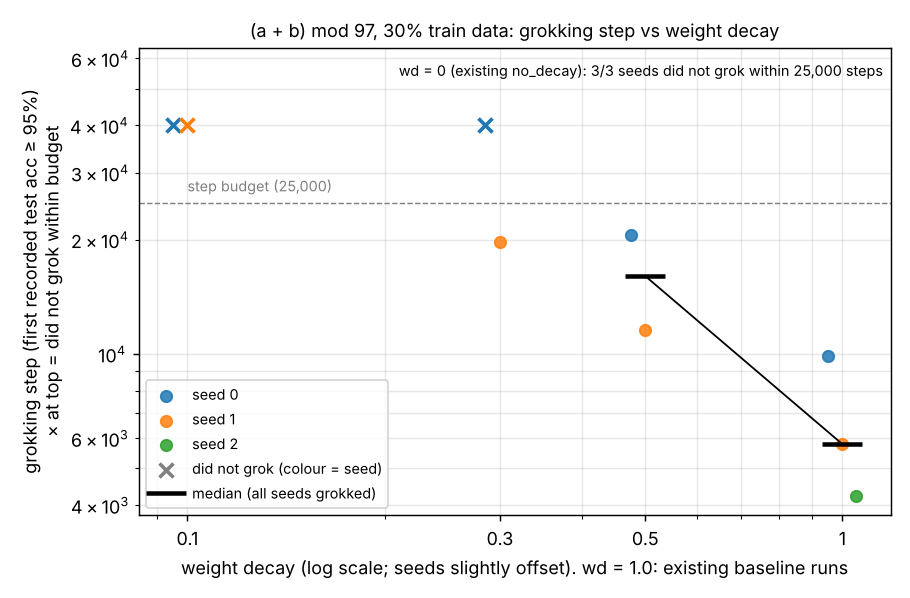

# Weight-decay sweep: when does grokking turn on?

2026-11-05. Branch `exp/wd-sweep`. Raw table: [`wd_sweep.csv`](wd_sweep.csv). Plot: [`wd_sweep.png`](wd_sweep.png). Script: [`wd_sweep.py`](wd_sweep.py).

## Method

Each sweep run is the `baseline` config from `train/config.py` (1-layer transformer, `(a + b) mod 97`, 30% of pairs for training, full-batch AdamW lr 1e-3, 25,000 steps) with one change, the weight decay, set on the command line:
`python train/train.py --run baseline --seed S --set weight_decay=W --tag wdW__seedS`.
No code or config defaults were changed. The seed goes in `--tag` because `--tag` names the output directory and the seeds must not overwrite each other. The grokking step uses the repo's own definition: the first *recorded* step at which test accuracy is ≥ 95% (`first_step(..., 0.95)` / `milestones()["test_95"]` in `train/plot.py`, the same rule `check_site.py` uses). A run that never reaches it is reported as "did not grok within 25,000 steps", with no extrapolation. The wd = 0 (`no_decay`) and wd = 1.0 (`baseline`) rows are the existing results, read from `site/data/runs/*.json` and not rerun. The sweep ran on a 4-core Linux CPU, one run per core.

**What was run vs. planned.** The plan was wd ∈ {0.03, 0.1, 0.3, 0.5} × seeds {0, 1, 2} (12 runs). A single run here takes ~58 min (vs ~4.5 min on the M3), so 12 runs would have missed the deadline. Per the instructions I dropped seed 2 first. Then a container restart killed the four wave-2 runs partway through, and the 2 h budget had no room to redo all of them. I reran wd 0.3 and 0.5 for seed 1 with 2 threads each, and dropped wd = 0.03. **Final: 6 sweep runs** (wd 0.1, 0.3, 0.5 × seeds 0, 1).

## Results

| weight decay | seed | source | grokking step (test acc ≥ 95%) | final train acc | final test acc |
|---|---|---|---|---|---|
| 0 | 0 | existing `no_decay` | did not grok within 25,000 steps | 100.00% | 3.02% |
| 0 | 1 | existing `no_decay` | did not grok within 25,000 steps | 100.00% | 4.05% |
| 0 | 2 | existing `no_decay` | did not grok within 25,000 steps | 100.00% | 4.33% |
| 0.1 | 0 | sweep (this PR) | did not grok within 25,000 steps | 100.00% | 5.50% |
| 0.1 | 1 | sweep (this PR) | did not grok within 25,000 steps | 100.00% | 8.11% |
| 0.3 | 0 | sweep (this PR) | did not grok within 25,000 steps | 100.00% | 12.80% |
| 0.3 | 1 | sweep (this PR) | 19,718 | 100.00% | 99.95% |
| 0.5 | 0 | sweep (this PR) | 20,514 | 100.00% | 100.00% |
| 0.5 | 1 | sweep (this PR) | 11,560 | 100.00% | 100.00% |
| 1 | 0 | existing `baseline` | 9,868 | 100.00% | 100.00% |
| 1 | 1 | existing `baseline` | 5,785 | 100.00% | 100.00% |
| 1 | 2 | existing `baseline` | 4,216 | 100.00% | 100.00% |

Not in the table: the killed wd = 0.03 runs (seed 0 at step 9,675, seed 1 at step 12,266) had test accuracy of 3.4% and 4.3% when they stopped. They were incomplete, so they carry no grokking step and no final accuracy.

**Reading.** Within the 25,000-step budget, grokking switches on between wd = 0.1 and wd = 0.5. At wd = 0.1, neither seed groks. At wd = 0.3, one of two does (step 19,718). At wd = 0.5, both do (20,514 and 11,560; median 16,037). At the existing wd = 1.0, all three do (median 5,785). Where it happens, grokking comes later as weight decay shrinks, and at wd = 0.3–0.5 it lands close to the budget, so the "did not grok" verdicts near the switch-on point are partly an artefact of the 25,000-step cut-off. The non-grokking runs are not static: final test accuracy rises with weight decay (3–4% at wd = 0, 5.5% and 8.1% at 0.1, 12.8% at 0.3) and was still climbing at step 25,000. With two seeds per setting, this locates the switch-on point only roughly and says nothing reliable about how the delay scales with weight decay.

## Limitations

- **Two seeds per sweep setting, not three.** Seed 2 was dropped for time. The existing baseline already shows a 2.3× spread in grokking step across 3 seeds, so two seeds give only a rough location, not a timing distribution. wd = 0.03 was not measured at all.
- **Single task, single modulus:** addition mod 97, 30% train fraction, one architecture. The weight decay at which grokking turns on probably depends on all of these (and on the learning rate, since AdamW decay is applied as lr × wd).
- **"Did not grok" means only "not within 25,000 steps".** Several of these runs still had test accuracy rising at the end, so a longer budget might show late grokking. Nothing here says they never would.
- **Different hardware and thread counts from the existing results.** The wd = 0 and 1.0 rows were trained on an Apple M3 CPU. The sweep ran on a Linux x86 CPU, with 1 thread per run (wave 1) or 2 threads (the two seed-1 reruns). Float reduction order differs across machines and thread counts, and the repo's log notes that a ~1e-8 difference once shifted the grokking step by 5%. Treat individual step numbers as approximate. The existing wd = 1.0 runs were not re-measured on this machine.
- **Threshold on recorded steps:** the grokking step is the first *recorded* step ≥ 95%, so it is quantised to the recording schedule (~2–5% of the step value). The context rows come from 4-dp-rounded site data.
